# Hoja de ruta · Hackathon SOC Tarvia

7 de noviembre de 2026 · @mazumbo

## Objetivo y principios

El domingo enseñamos un N1 con IA que tría bien cualquier alerta, lo explica con evidencias y deja claro dónde decide la persona; los niveles 2 a 4 son extra, solo si el nivel 1 ya funciona. Las horas van como H0 a H24 desde el arranque del equipo; ajustadlas a la hora real de entrega.

Reglas para decidir cuando dudemos:

- **Demo de punta a punta antes que perfección.** En H6 tiene que haber algo que coja una alerta y pinte un ticket en pantalla, aunque sea feo.
- **El código calcula, el LLM argumenta.** Matriz de severidad, cambios aprobados y filtros de ruido van en código determinista; el modelo investiga y redacta.
- **Probamos contra nuestra verdad.** Los 12 incidentes de [`incidentes_localizados.md`](incidentes_localizados.md) son el examen interno: si el sistema no los saca, no avanzamos de nivel.
- **Honestidad visible.** Una pestaña en la demo con lo que el sistema no resuelve puntúa, no resta.
- **Diferencial:** el turno de noche (cuánto antes habríamos detectado cada incidente), el abogado del diablo y la detección de prompt injection.

## Roles

Cuatro roles con un dueño cada uno; pon el nombre de cada persona en la columna Persona.

| Rol | Persona | Qué posee | Entregable clave |
| --- | --- | --- | --- |
| A · Datos y motor determinista |  | API mock, carga de datos, pre-filtro de ruido, matriz de severidad, cambios aprobados, correlación por entidades | Función `prefiltrar(alerta)` y `agrupar(alertas)` con tests |
| B · Agente IA |  | Agente con herramientas sobre la API, un playbook por regla basado en los runbooks, salida en `ticket_salida.schema.json`, defensa contra prompt injection, abogado del diablo | Función `triar(alerta) -> ticket` estable en las 150 alertas de desarrollo |
| C · Interfaz y demo |  | Cola de alertas por SLA, detalle del ticket con la traza de herramientas, botón de aprobación humana, vista de incidente con línea temporal | Pantalla que se pueda enseñar en directo |
| D · Analista, evaluación y pitch |  | Verdad propia de incidentes, evaluación continua, métricas del turno de noche, página para el comité, guion y ensayos | Informe de aciertos y guion de 5 minutos |

D es quien mejor entiende la parte de ciberseguridad: revisa los veredictos de B y decide qué casos se enseñan.

## Fases

```mermaid
gantt
    title Hoja de ruta · 5 fases, 5 hitos (H0 = arranque)
    dateFormat H
    axisFormat H%H
    section Fases
    Arranque                 :f0, 0, 1h
    N1 mínimo                :f1, 1, 5h
    N1 fiable + N2           :f2, 6, 6h
    N3, N4 y extras          :f3, 12, 6h
    Pulir y ensayar          :f4, 18, 6h
    section Hitos
    H1 Arranque              :milestone, 1, 0h
    H6 N1 de punta a punta   :milestone, 6, 0h
    H12 N1 fiable + N2       :milestone, 12, 0h
    H18 Congelación          :milestone, 18, 0h
    H22 Ensayo general       :milestone, 22, 0h
```

La mitad del tiempo va al nivel 1: es lo que más pesa en la nota. Los rombos son los hitos de control de la sección siguiente.

| Fase | A · Datos y motor | B · Agente IA | C · Interfaz | D · Analista y pitch |
| --- | --- | --- | --- | --- |
| H0 a H1 · Arranque | Levantar la API mock y repo común | Elegir modelo, probar la clave y una llamada con herramientas | Elegir framework (Streamlit o React) y esqueleto | Leer política y runbooks; repartir los 12 incidentes como casos de prueba |
| H1 a H6 · N1 mínimo | Matriz de severidad en código; pre-filtro de pentest, Nessus, SCCM y flujos aprobados | Agente que tría una alerta con herramientas y devuelve el ticket en JSON | Cola de alertas y vista de ticket con la traza | Etiquetar a mano unas 40 alertas de desarrollo como verdad |
| H6 a H12 · N1 fiable + N2 | Correlación por usuario, host, IP y hash en ventana de 24 h a varios días | Playbooks por regla, defensa contra prompt injection, confianza calibrada | Vista de incidente agrupado y línea temporal | Script de evaluación contra nuestra verdad; repetirlo en cada cambio |
| H12 a H18 · N3, N4 y extras | Métricas del turno de noche: hora del SOC humano frente a la nuestra | Informe de incidente (N3), abogado del diablo, propuesta de contención | Botón de aprobación que llama a `/approvals` y `/containment` | Borrador del guion y de la página del comité |
| H18 a H24 · Pulir y ensayar | Pre-calcular resultados por si falla la red | Robustez con alertas raras o con campos vacíos | Pulido visual y modo presentación | Ensayos con cronómetro y vídeo de respaldo |

Cada uno duerme al menos 3 horas entre H12 y H20, en dos turnos de dos personas.

## Hitos de control y recortes

En cada hito paramos 10 minutos todos juntos; si no se cumple el criterio, aplicamos el recorte y no seguimos añadiendo cosas.

| Hito | Criterio para pasar | Si no se cumple, recortamos |
| --- | --- | --- |
| H1 · Arranque | API mock en marcha, clave del LLM probada, repo con estructura y ramas | Nada: es bloqueante, todos ayudan |
| H6 · N1 de punta a punta | Una alerta entra, el agente consulta la API y la interfaz muestra un ticket válido | La UI pasa a Streamlit mínimo; B solo cubre las 10 reglas más frecuentes |
| H12 · N1 fiable + N2 | Las 150 de desarrollo se trían sin errores; el pre-filtro cierra el ruido con motivo; se agrupan los 12 incidentes | Abandonamos N3 y N4; todo el equipo a calidad del N1 |
| H18 · Congelación | Ninguna funcionalidad nueva desde aquí; los incidentes de nuestra verdad salen bien | Quitamos de la demo lo que falle; lo contamos como límite |
| H22 · Ensayo general | Demo completa en 5 minutos, dos veces seguidas sin fallos | Plan B: vídeo grabado y tickets pre-generados |

Orden de recorte si vamos tarde: primero N4 (contención), luego N3 (informe de investigación), luego el abogado del diablo. El turno de noche y la detección de prompt injection no se recortan: son baratos y son lo que nos diferencia.

## Preparación de la defensa

La defensa tiene tres piezas y cada una tiene dueño.

1. **Demo visual (C y D).** Guion de 5 minutos:
   1. El problema: 4.000 alertas al día y nadie mira de noche.
   2. Cola en directo: el pre-filtro cierra el ruido y explica por qué.
   3. Una alerta de phishing con prompt injection: el sistema la marca como intento de manipular a la IA.
   4. Un incidente de varios días (ransomware o cadena de suministro) agrupado en un solo ticket con línea temporal.
   5. La persona aprueba una contención con el botón.
   6. Turno de noche: horas ganadas y euros.
   7. Límites honestos.
2. **Las 10 alertas en directo (B y D).** Que una alerta nueva se tríe en menos de un minuto y nunca rompa la interfaz. Probad con alertas aleatorias de `alertas.jsonl` que no sean de desarrollo, y con alertas inventadas con campos vacíos.
3. **Página para el comité (D).** Una sola página, sin jerga: qué hemos encontrado (12 incidentes, 4 críticos), cuánto antes los habríamos visto, cuánto trabajo ahorra al SOC, qué decide siempre una persona y qué riesgos quedan.

Preguntas que nos harán, con respuesta preparada:

- ¿Qué pasa si el LLM se equivoca? El abogado del diablo, la confianza y la aprobación humana para todo lo disruptivo.
- ¿Cuánto cuesta por alerta? Medid tokens y segundos por alerta durante la evaluación.
- ¿Cómo sabéis que acierta? Nuestra verdad de 12 incidentes y la tabla de benignos, con el porcentaje de aciertos.
